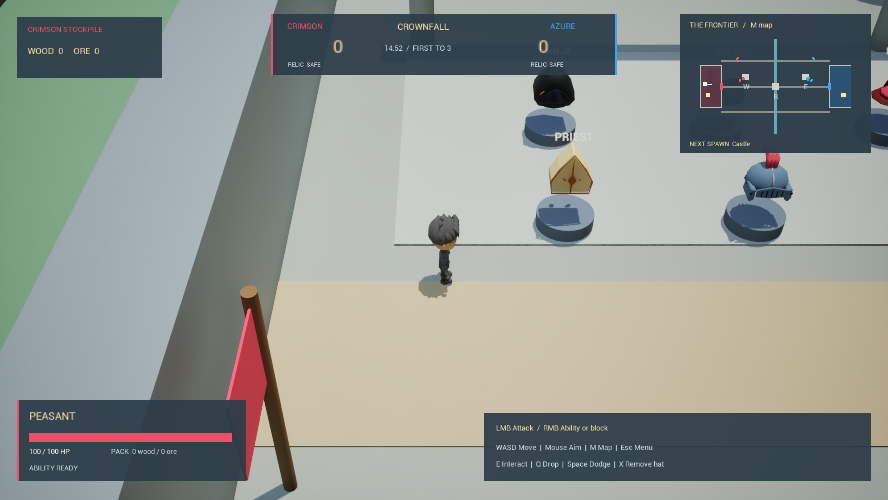

# Crownfall

A third-person, team-based castle warfare prototype built with Unreal Engine 5.8. Pick a class hat, gather resources, upgrade your team, capture forward outposts, breach the enemy gate, and bring their relic home.



## Source-only repository

This repository contains C++ source, Unreal build rules, the project descriptor, shared configuration, and the screenshot above. Unreal assets (`Content/`), source art, compiled binaries, caches, generated files, local tools, and credentials are intentionally excluded.

**The screenshot shows the complete local project. A fresh clone does not contain the maps, models, animations, materials, Blueprints, or class data needed to play.** Restore the corresponding `Content/` assets separately before launching a match. Git LFS is not required for this source snapshot.

## Gameplay

- Peasant, Worker, Knight, Priest, Mage, Archer, and Ninja classes, with team-wide upgrades.
- Melee, projectiles, blocking, healing circles, life drain, charged area attacks, ice slows, and dodging.
- Workers harvest wood and ore, fund upgrades, and repair destructible gates.
- Three outposts support forward respawning at the furthest safe owned point.
- Server-authoritative relic capture, team assignment, combat, resources, upgrades, and match flow.
- Eighteen bots with combat, worker, defender, and support roles.
- Minimap, tactical map, start/pause/settings menus, solo matches, and LAN/direct-IP multiplayer.

## Build

Install Unreal Engine 5.8 and a supported Visual Studio C++ toolchain. Generate project files from `CastleCTF.uproject`, then build `CastleCTFEditor` in **Development Editor / Win64**. Alternatively, run this from the repository root, adjusting the engine installation path:

```powershell
& 'C:\UE_5.8\Engine\Build\BatchFiles\Build.bat' CastleCTFEditor Win64 Development "-Project=$PWD\CastleCTF.uproject" -WaitMutex
```

With the separately supplied assets restored, open the project and play the default `/Game/Crownfall/Maps/FrontEnd` map. Choose **Single player** or **Multiplayer**. A host can start a LAN match; another player can join using the host's IP address. Public matchmaking is not implemented.

## Controls

| Input | Action |
| --- | --- |
| WASD / mouse | Move / aim |
| Left mouse | Primary attack; Priest heals; Mage clicks for a burst or holds/releases to charge |
| Right mouse | Class ability or Knight block |
| Space | Dodge |
| E / Q | Interact / drop carried object |
| X | Remove class hat |
| M / Escape | Tactical map / menu |

## Code layout

Core gameplay is in `Source/CastleCTF/RelicGame/`:

- `RGGameMode`, `RGGameState`: match flow, spawning, teams, scores, and upgrades.
- `RGCharacter`, `RGComponents`, `RGAreaCombat`: movement, equipment, health, combat, and carrying.
- `RGWorldActors`, `RGOutpost`: gates, resources, stations, relics, and capture points.
- `RGArena`, `RGArenaLandscape`: battlefield construction.
- `RGBotController`, `RGBotStrategy`: bot movement and decisions.
- `RGHUD`, `RGMinimap`, `RGMenu`: gameplay UI and menus.
- `RGValidation`, `RGFrontierValidation`, `RGEditorValidation`, `RGMotionValidation`: runtime and multiplayer validation helpers.

The other source folders retain the project's Unreal template variants. `Config/DefaultGame.ini` controls bot count, countdown, respawn time, match duration, and captures required to win. Asset-based class tuning lives in the separately supplied `/Game/Crownfall/Data/DA_Classes` asset.

## Validation and scope

The local project has been built for Win64 Editor and Game targets and checked with automated core-loop, ability, outpost, animation, and two-player PIE tests. Those runtime checks require the excluded assets. The project remains a prototype: bot tactics and animation transitions can improve, and a 32-player stress test has not been completed.
